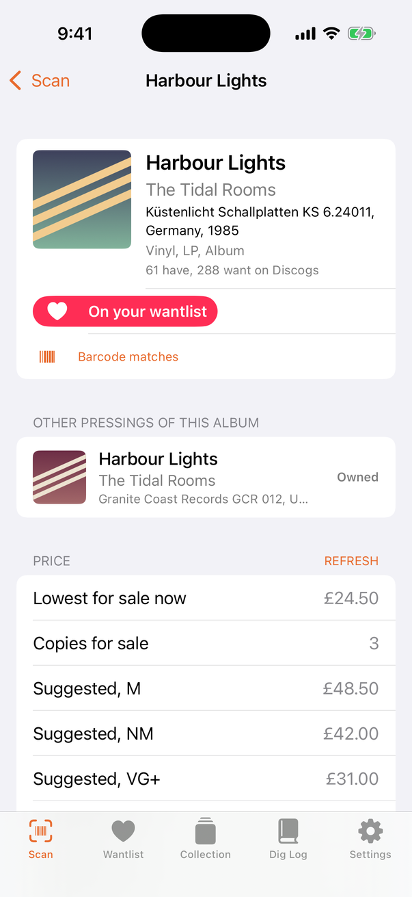
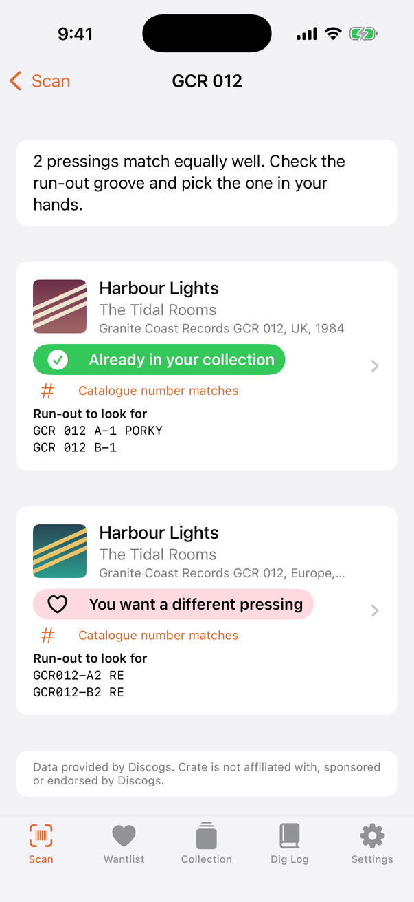
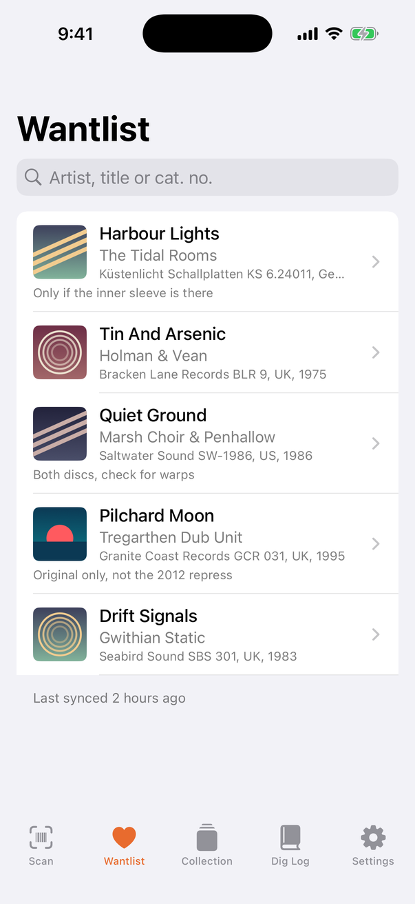
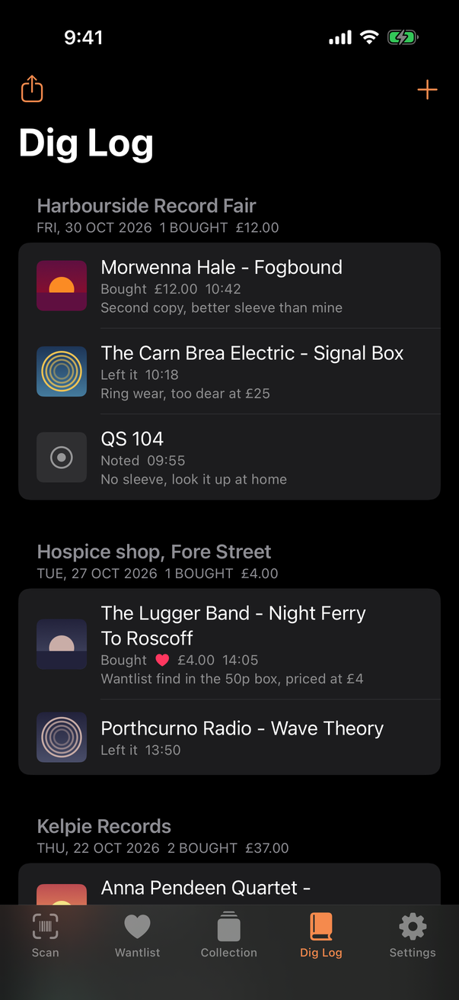

# Crate

[](https://github.com/banjonay1992/crate/actions/workflows/ci.yml)
[](LICENSE)

Crate is an iPhone app for digging through records in charity shops, car boot sales and record fairs. Scan the barcode on a sleeve, or type the catalogue number or the matrix number etched in the run-out groove, and Crate identifies the exact pressing on Discogs. It then tells you straight away whether that pressing is on your wantlist, whether you already own it (or a different pressing of the same album), and what it sells for on the Discogs marketplace.

**Status:** version 0.1.0. What works: barcode and manual lookup, pressing identification, owned and wanted badges, prices, the offline cache and lookup queue, and the dig log with CSV export. CrateCore is tested on macOS and Linux in CI, and the app builds and runs in the iOS Simulator, which is where the screenshots below come from. It has not yet been field tested on a phone or run against the live Discogs API; that, and a TestFlight beta, are the [v0.2 milestone](https://github.com/banjonay1992/crate/milestone/1).

<p>
  
  
  
  
</p>

From left: a barcode match, a catalogue number shared by two pressings, the wantlist, and the dig log in dark mode. Every record, label, shop and price shown is invented demo data. The other screens, in light and dark, are in [docs/screenshots](docs/screenshots).

Shops often have no signal, so Crate keeps your collection and wantlist on the phone, answers what it can offline, and queues anything it cannot answer until you are back online. A dig log records what you found, where and when. The shop name is whatever you type; Crate does not use location.

## Who it is for

People who buy records second hand and use Discogs to track their collection and wantlist. It is most useful when you are stood at a crate with a stack of sleeves and need a quick yes or no, and when the record in your hand is one of several pressings that share a catalogue number.

## What it does

- **Scan or type.** The camera reads EAN-13, EAN-8, UPC-A and UPC-E barcodes. Records without a barcode (most from before the early 1980s) can be looked up by catalogue number or by matrix / run-out text.
- **Pressing identification.** Crate searches Discogs, fetches details for the strongest candidates and compares identifiers. A barcode or a full matrix string identifies a single pressing; a catalogue number shared by an original and a reissue produces a short list, with the run-out etchings unique to each pressing so you know what to look for in the groove.
- **Owned and wanted at a glance.** A badge says "On your wantlist", "Already in your collection", "You want a different pressing" or "You own a different pressing", using the Discogs master release to link pressings of the same album.
- **Prices.** The lowest current listing and number for sale from Discogs marketplace statistics, plus suggested prices by condition where your Discogs account has seller settings filled in. Prices are cached and shown with their age when offline.
- **Offline.** Collection, wantlist, previously seen releases and prices are stored on the phone. With "Save wantlist details for offline matching" on, a sync also fetches each wantlist release once, so barcodes and run-outs on your wantlist match with no signal at all. Lookups made offline are queued and run automatically when the connection returns.
- **Dig log.** Log records as bought, left behind or noted, with price paid, the market price at the time and a note. Entries are grouped into visits by shop and day with totals per currency, and the whole log exports as CSV.

## Built with

- Swift 6 and SwiftUI, targeting iOS 17 and later.
- AVFoundation for barcode scanning, Network for connectivity, Security for the Keychain.
- CrateCore, a local Swift package with no third-party dependencies, holding the Discogs client, models, matching logic, offline storage and dig log. It builds and is tested on macOS and Linux.
- XcodeGen to generate the Xcode project from `project.yml`.
- GitHub Actions for continuous integration.

## Running it

You need a Mac with Xcode 16 or later and [XcodeGen](https://github.com/yonaskolb/XcodeGen).

```sh
brew install xcodegen
git clone https://github.com/banjonay1992/crate.git
cd crate
xcodegen generate
open Crate.xcodeproj
```

Choose the Crate scheme and an iPhone simulator or device. For a device, set your own development team under Signing & Capabilities; the bundle identifier `uk.co.nayproductions.crate` can be changed in `project.yml`. The simulator has no camera, so the Scan screen says so and you use "Type a barcode, cat. no. or run-out" instead.

### Demo mode

Debug builds have a demo mode for trying the app without a Discogs account, and for screenshots. It fills the app with invented records, a collection, a wantlist, prices and a dig log, all held in memory. It does not use the network, does not read or write the Keychain, and leaves any real data on the device alone. Release builds ignore it.

Turn it on with launch arguments. In Xcode, choose Product > Scheme > Edit Scheme, open Run > Arguments and add `-CrateDemo YES`. Add `-CrateScreen` followed by one of these names to open on a particular screen:

| Name | Opens on |
| --- | --- |
| `scan` | The Scan tab. On the Simulator this shows the no-camera fallback. |
| `manual` | Manual entry with a catalogue number already typed. |
| `result` | A barcode lookup that finds one pressing: on your wantlist, with a different pressing owned, and prices. |
| `pressings` | A catalogue number shared by an original and a reissue, with the run-outs that tell them apart. |
| `wantlist`, `collection`, `diglog`, `settings` | That tab. |

From the command line, with a simulator booted and a Debug build installed:

```sh
xcrun simctl launch booted uk.co.nayproductions.crate -CrateDemo YES -CrateScreen result
```

The demo data is in `Packages/CrateCore/Sources/CrateCore/Demo`, next to a stand-in for the Discogs API that answers from it, so lookups in demo mode run through the real matching code. `DemoLibraryTests` checks that the data still tells the stories in the screenshots. Sleeve art in demo mode is drawn by the app from the release ID; no images are bundled.

To refresh the screenshots, run the Screenshots workflow from the Actions tab or with `gh workflow run screenshots.yml`. It builds the app, sets a clean status bar on an iPhone simulator, launches each screen in light and dark appearance, and attaches the images to the run and to a draft release named "screenshots". Scale them to half size before committing them to `docs/screenshots`.

### Getting a Discogs token

Crate uses a Discogs personal access token, which lets it read your own collection and wantlist.

1. Sign in at discogs.com and open Settings, then Developers.
2. Choose "Generate new token" and copy it.
3. In Crate, open Settings, paste the token and tap Connect.

Crate checks the token with Discogs, stores it in the iOS Keychain (this device only, not backed up or synced), and runs a first sync. Disconnecting removes the token and all cached Discogs data from the phone; the dig log is kept.

For development you can avoid pasting the token on every fresh install. Copy `Config/Secrets.example.xcconfig` to `Config/Secrets.xcconfig` and set `DISCOGS_TOKEN`. That file is git-ignored. Debug builds use it only when no token is in the Keychain, and Release builds blank it out, so it is never shipped. Note that a value placed in an xcconfig ends up in the Debug app's Info.plist, so treat Debug builds that contain it as private.

### Tests

The core logic is covered by XCTest unit tests that run against invented fixture JSON and a scripted mock transport, so they never touch the network or wait in real time.

```sh
swift test --package-path Packages/CrateCore
```

CI runs these on macOS and Linux, then generates the project and builds the app for the iOS Simulator.

## Architecture

```
App/                      SwiftUI app target
  Sources/AppModel.swift  App state; bridges SwiftUI and CrateCore
  Sources/Services/       Keychain token store, settings, connectivity monitor
  Sources/Views/          Scan, Result, Wantlist, Collection, Dig Log, Settings
  Sources/Demo/           Launch arguments and generated sleeve art for demo mode
  Resources/              Asset catalogue, privacy manifest
Packages/CrateCore/       Platform-independent logic, no dependencies
  Discogs/                Client, wire formats, rate limiter, transport
  Models/                 Release, pressing identifiers, collection, wants, prices
  Matching/               Barcode and identifier normalisation, pressing matcher, ownership index
  Storage/                File-based key-value store, library cache
  Lookup/                 Lookup service, offline lookup queue, sync service
  DigLog/                 Dig log store and CSV export
  Demo/                   Invented demo data and an in-memory Discogs stand-in (Debug only)
Config/                   xcconfig files; Secrets.xcconfig is git-ignored
project.yml               XcodeGen spec (the .xcodeproj is generated, not committed)
docs/screenshots/         Simulator screenshots used in this README
.github/workflows/        CI, and the manual Screenshots workflow
```

Some design notes:

- **Networking.** `DiscogsClient` sits behind a `DiscogsAPI` protocol and takes an injectable `HTTPTransport`, so tests script responses without a network. Every request sends a User-Agent, as Discogs requires. A shared `RateLimiter` actor reserves request slots in a sliding 60 second window (Discogs allows 60 authenticated requests a minute), reads the `X-Discogs-Ratelimit` headers to slow down when the allowance runs low, and backs off exponentially with jitter after a 429 or a server error, honouring `Retry-After` when present. Connection failures become `DiscogsError.offline`, which is what triggers queueing.
- **Identifiers.** Barcodes are validated with the GS1 check digit and reduced to one canonical form, because Discogs stores them as printed ("5 012345 600123") and the same product can appear as 12-digit UPC-A or 13-digit EAN-13. UPC-E is expanded. Catalogue numbers and matrix strings are compared on keys that ignore case, spacing, punctuation and accents, with a looser catalogue key that also ignores leading zeros.
- **Matching.** Evidence is ranked: barcode and full matrix first, then exact catalogue number, partial matrix, loose catalogue number, and finally "Discogs returned it but nothing lines up". A strictly strongest candidate is a match; a tie is shown as a choice.
- **Storage.** Small Codable JSON files written atomically, with iOS file protection and a schema version so an incompatible file is discarded instead of crashing the app. Cached Discogs data is excluded from iCloud backup because it can be re-downloaded; the dig log and the offline queue are backed up.

## Privacy

Crate has no accounts of its own, no analytics, no advertising and no tracking. It talks to one service, the Discogs API, using your token, and only when you look something up or sync. Camera frames are processed on the device to read barcodes and are never recorded or sent anywhere. Location is never requested; the shop name in the dig log is whatever you type.

Data on the phone: your Discogs token in the Keychain; your collection, wantlist, cached release details and prices in the app's Application Support folder; the dig log and offline queue in the same place. Deleting the app removes all of it.

The privacy manifest (`App/Resources/PrivacyInfo.xcprivacy`) declares no tracking, no collected data types, and UserDefaults use for app settings (reason CA92.1).

## Discogs data and attribution

Crate uses the Discogs API and is bound by the Discogs API Terms of Use, linked from the [Discogs developer documentation](https://www.discogs.com/developers). This application uses Discogs' API but is not affiliated with, sponsored or endorsed by Discogs. "Discogs" is a trademark of Zink Media, LLC.

The app shows "Data provided by Discogs" alongside release and price information and links each release back to its page on discogs.com. Data fetched from Discogs is cached on the user's own device for their own use and is not redistributed. Marketplace prices and images belong to Discogs and its users. Anyone publishing a build of Crate should read the current terms, register the application on Discogs, and keep the attribution in place.

## Limitations

- **Not yet tested on a phone.** The app builds in CI and runs in the iOS Simulator in demo mode, which is where the screenshots come from, but it has not been run on real hardware and has no UI tests yet. The camera scanner in particular cannot run in the Simulator, so treat scanning as untested until someone has stood in a shop with it ([#1](https://github.com/banjonay1992/crate/issues/1)).
- **Matrix search is a heuristic.** The Discogs search API has no field for matrix numbers. Crate searches the identifier index first, falls back to free-text search, then confirms by comparing the run-out strings on the candidates. Etchings are transcribed inconsistently on Discogs, so partial matches are shown as such.
- **Discogs behaviour is assumed from its documentation.** Response shapes in the fixtures mirror the documented API but the data is invented, and the test suite has never talked to the real service.
- **Personal tokens only.** There is no OAuth sign-in yet, so each user generates their own token.
- **Price suggestions** need the user's Discogs seller settings to be filled in and come back in the currency set there, which may differ from the currency chosen in Crate.
- **Offline matching is only as good as the cache.** Barcode and run-out matching offline works for releases Crate has seen before and, with the prefetch setting on, for the wantlist. Collection items are matched offline by catalogue number only.
- **Sleeve images are not cached** and do not appear offline.
- **Large wantlists** take several syncs to prefetch fully, because of the 60 requests per minute limit.

## Roadmap

Planned work, with rough estimates, is in [ROADMAP.md](ROADMAP.md). Each item is a GitHub issue with acceptance criteria, filed under the [v0.2](https://github.com/banjonay1992/crate/milestone/1), [v0.3](https://github.com/banjonay1992/crate/milestone/2) and [Later](https://github.com/banjonay1992/crate/milestone/3) milestones. Issues labelled [good first issue](https://github.com/banjonay1992/crate/labels/good%20first%20issue) are small and self-contained.

## Licence

MIT. See [LICENSE](LICENSE).
